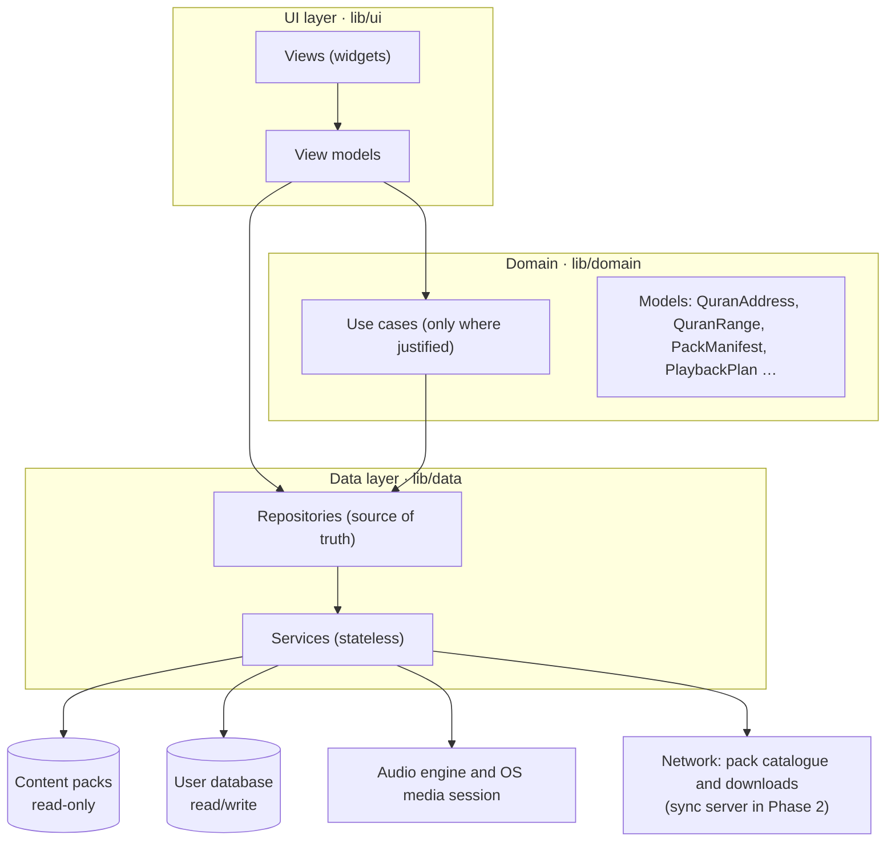
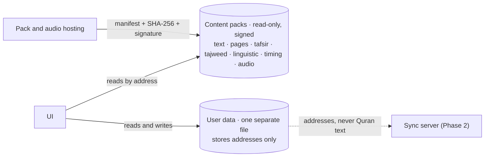

# Architecture

Product behaviour is defined by the PRD (`docs/prd/PRD.ar.md`). This file says how the
code is organised to deliver it. Items marked **Proposed** are engineering defaults
set during planning, before any code ran. Each is confirmed or replaced during
Phase 0 by the spike or milestone named for it in `docs/DECISIONS.md`, and the outcome
is recorded there.

## Principles

1. **The Quran text is read-only data, never code.** It lives in verified content
   packs and reaches the screen by address, byte for byte (PRD §9).
2. **One address for everything.** `riwaya:surah:ayah[:word]`, for example
   `hafs:2:255` and `hafs:2:255:3`. Page, juz, hizb, rub and line are looked up in the
   reference edition's map (KFGQPC 1421H). They are never part of an address or of
   stored user data.
3. **Local first.** Reading, navigation, search, bookmarks and notes work from
   install with no network and no account (PRD §10.5).
4. **A feature without verified data does not exist.** Content appears only when its
   pack is installed and has data for that ayah. Nothing is generated, estimated or
   filled in. What the user sees when data is absent is defined in
   `docs/DESIGN_SYSTEM.md`, "When data is missing".
5. **Dependencies point one way:** UI → (use cases) → repositories → services.
6. **The identity is applied through tokens and shared components**
   (`docs/DESIGN_SYSTEM.md`).

## Layers

The app follows the Flutter team's architecture guide
(<https://docs.flutter.dev/app-architecture/guide>) and its recommendations
(<https://docs.flutter.dev/app-architecture/recommendations>): MVVM in the UI layer,
the repository pattern in the data layer, an optional domain layer, unidirectional
data flow, immutable models, dependency injection.



| Component | Does | Must not |
| --- | --- | --- |
| View | Lays out widgets, animation, simple show/hide from view-model state | Hold business logic, call repositories or services, touch plugins |
| View model | Turns repository data into UI state, exposes commands. One per view. | Import Flutter widgets beyond `ChangeNotifier`/`Listenable`, know about SQL or files |
| Use case | Combines repositories or holds logic reused by several view models | Exist "for symmetry". Add one only when needed |
| Repository | Single source of truth for one kind of data; caching, errors, retries; returns domain models | Know about another repository; leak raw rows or plugin types |
| Service | Wraps one data source (SQLite file, file system, audio plugin, HTTP) | Hold state |

### Content layers (PRD §10.1)



There is no path by which an edit can reach the Quran text: the UI cannot write to
packs, user data holds addresses, and the sync schema has no text field.

## Source layout

Feature UI is grouped by feature; data and domain code by type (the layout used by the
official architecture skill).

```
lib/
  main.dart                    bootstrap only
  config/                      dependency wiring, environment
  routing/                     go_router configuration
  domain/
    models/                    immutable, pure Dart
    use_cases/
  data/
    models/                    raw rows and transport models
    repositories/              abstract class + implementation per area
    services/                  one class per data source
  ui/
    core/
      theme/                   tokens.g.dart and ramps.g.dart (generated), theme extensions
      widgets/                 the design-system components, with their metrics
      metrics/                 <screen>_metrics.dart: layout values read from a board
      gallery/                 debug-only gallery of the design-system widgets
      app.dart, tab_shell.dart the root widget and the five-tab shell
      l10n/                    digit and plural helpers
    features/
      <feature>/
        view_models/
        views/
  utils/                       Result, Command, small pure helpers
  l10n/                        app_ar.arb
test/                          mirrors lib/; test/guards and test/integrity besides
testing/                       fakes and fixtures shared by tests
integration_test/
tools/
  gen/                         Dart generators: design tokens, icons
  packs/                       content pipeline: source file to verified pack
  ziydia/                      extraction tool for the Zaydi Library
assets/                        fonts (copied from design/, hash-checked), the base pack's data
data/                          ignored by Git: raw/ downloaded sources, build/ built packs
design/                        the approved identity; reference only, never imported
```

Generated Dart files end in `.g.dart`, are committed, and are never edited by hand. The
one exception to the suffix is the localisation output of `flutter gen-l10n`,
`lib/l10n/app_localizations*.dart`, whose names the tool fixes; it is committed and
checked the same way.

Features: `onboarding`, `home`, `mushaf` (reader), `index` (navigation), `listen`,
`study` (tafsir, search, ayah sheet), `more` (bookmarks, notes, resources, settings,
sources and licences). Later phases add `khatma`, `hifz`, `account`.

### Naming

`MushafScreen` · `MushafViewModel` · `BookmarkRepository` (abstract) and
`LocalBookmarkRepository` · `PackFileService`. File names in `snake_case`. A test file
sits at the mirrored path with `_test.dart`.

### Import rules

- `lib/domain` imports no Flutter package, no `dart:io`, `dart:isolate` or `dart:ffi`,
  and nothing from `lib/data` or `lib/ui`.
- `lib/ui` imports `lib/domain` and repository interfaces; never `lib/data/services`,
  `dart:io` or a database package.
- Only `lib/data/services` imports plugins.
- Only `lib/data/services/pack_database.dart` imports `sqlite3`, and it opens every
  pack read-only and immutable (D-061).
- Feature folders do not import each other; shared widgets live in `ui/core/widgets`.
- Only `lib/ui/core` imports the generated colour ramps (`ramps.g.dart`).

Guard tests in `test/guards/` enforce these.

## State and navigation

- View models extend `ChangeNotifier`; views rebuild with `ListenableBuilder`. User
  actions go through commands, and fallible calls return a `Result`
  (<https://docs.flutter.dev/app-architecture/design-patterns/command>,
  <https://docs.flutter.dev/app-architecture/design-patterns/result>).
- Dependencies are injected through constructors and provided with `provider`.
  **Proposed**: decision D-021.
- App-wide state (playback, download queue, settings, theme, UI level, last position)
  is owned by repositories and exposed as `Listenable` or `Stream`; view models
  subscribe. No global singletons reached from widgets.
- Navigation uses `go_router` with a stateful shell of five branches, one per tab:
  الرئيسية، المصحف، الاستماع، الدراسة، المزيد. Each tab keeps its own stack. Every
  Quranic address is a route inside the app (`NV-06`); links from outside the app
  arrive in Phase 2 (`NV-06`, `SH-04`).
- The UI level (بسيط، متوسط، دراسة) is one setting. It changes which tools are shown,
  not where they are, and never deletes data (`LV-01`…`LV-04`, PRD §7.3).

## Domain core

| Type | Notes |
| --- | --- |
| `QuranAddress` | `riwaya`, `surah`, `ayah`, optional `word`. Parses and prints the canonical form (D-063). Validated against the installed pack's counts, not against constants in code. |
| `QuranRange` | Start and end address in the same riwaya and granularity (D-063). |
| `EditionMap` | Page, juz, hizb, rub and sajda lookups for the reference edition. |
| `PackManifest`, `VerifiedPack` | The fields of PRD §9.2 (`docs/CONTENT_PACKS.md`); a pack whose signature, files and hashes passed (D-065). |
| `SurahInfo`, `WordSpan` | Surah metadata from the pack; a word's half-open UTF-16 offsets into its ayah. |
| `PackFailure` | Sealed: every way a pack is refused or disabled. Returned in a `Result` (D-066). |
| `PackText` | **Decided** (D-062). An opaque wrapper for any string read from a text pack. It has no method that transforms it. See "Keeping pack text untouched". |
| `PlaybackPlan` | Ordered timed segments with repeats and silences (PRD §8.3). Pure Dart, tested without audio. |

Surah names, ayah counts and every other fact about the Quran come from the pack.
Nothing of that kind is typed into Dart code.

## Content packs

A pack is a manifest plus one or more data files.

| Pack | Content | Delivery | Phase |
| --- | --- | --- | --- |
| Base | Hafs text (Tanzil Uthmani 1.1), indexes, source-provided search forms. The PRD counts the fonts with it; in the build they are Flutter font assets in `assets/fonts/`, and the manifest names the Quran font and its hash | Bundled | 1 |
| Mushaf pages | KFGQPC page fonts and line layout for 604 pages (1421H) | Downloaded on first use of page mode | 1 |
| KFGQPC Hafs script | KFGQPC Hafs text and its font, the second script in surah mode (`RD-19`) | Optional | 1 |
| Tafsir | One book per pack | Optional; one short tafsir on first use | 1 |
| Recitation | Audio files and timing | Optional; by surah, juz or whole | 1 |
| Tajweed, riwaya, gharib | | Optional | 2 |
| Linguistic | Morphology, roots, word i'rab | Optional | 3 |

Rules, all from PRD §9:

- Data files are opened read-only, in a file separate from user data.
- No Unicode normalisation, cleaning or re-encoding of pack text anywhere in the code.
- A text pack names its font; the text is never drawn with another font.
- The manifest is signed; the public key ships in the app. **Proposed**: Ed25519.
  Who holds the private key and where signing runs is an open decision (D-024). The
  private key never enters this repository. Until then the check is a seam that
  reports "not checked", and no pack ships (D-065).
- Verify signature and SHA-256 at build, after download and before activation. On the
  first run after install or update verify the whole base pack; when a surah is
  opened verify that surah's hash once per session. On failure show the integrity
  alert, show no text from that pack, and restore or re-download. The failure is
  logged on the device; a report leaves it only if the user agreed to diagnostics
  (PRD §9.5).
- Activation is atomic and the previous version can be restored (`OF-06`).
- A pack with no complete entry in `docs/SOURCES.md` is not built.
- A new tafsir, recitation or riwaya arrives as a pack with a signed manifest, with
  no new app release (`NF-19`). The bundled Hafs text is the exception: it changes
  only with an app release.

### Who defines the format

Storage is one read-only SQLite database per pack, opened immutable through the
`sqlite3` package (D-061); full-text search for the base pack and tafsir packs comes
with M1.8 (PRD §10.8).

- The format is specified in `docs/CONTENT_PACKS.md` (version 1, D-064). Stream A
  wrote it in M0.3, because the reader defines what it can read; the planning session
  reviews it in the pull request.
- The pipeline that produces packs lives in `tools/packs/` and belongs to stream B.
  **Proposed**: Python 3 with the standard library, so that the owner can run it on
  his computer as he runs the extraction tool; signing is one separate step.
- The two sides meet only through that document and through packs. A pack is
  accepted when the app's verification and the integrity suite pass on it
  (`--dart-define=HOLYQURAN_PACK_DIR`, D-067).
- Until a real pack exists, tests build synthetic packs whose text is plainly not
  Quran text.

### One word index

Sources split words differently. The app's index is the whitespace-separated words of
the Tanzil text, which is also what the timing data uses. Every other source gets a
mapping table built once and checked automatically; a word with no counterpart stops
the pack build (PRD §10.4).

**Proposed**, to be fixed in B0.4 against the timing data: a token made only of marks
(a pause mark, a sajda or rub sign) is not a word. It has no word number, stays
attached to the word before it for layout, and is what `WQ-01`…`WQ-03` address.

## Keeping pack text untouched

The string that reaches the screen, the clipboard, a share card or an export is the
pack string.

Allowed, and nothing else:

- **Placing whole values side by side.** Consecutive ayat in surah mode, with their
  markers between them; several ayat copied together, each with its number (`SH-01`).
- **Wrapping a whole value in a fixed format.** The copy format
  `﴿…﴾ [السورة: الرقم]`, whose brackets and reference are UI strings.
- **Slicing at offsets stored in the pack.** One span per word for hit testing and
  highlights. The slices of an ayah, joined in order with nothing added, equal the
  ayah; a test asserts this for every ayah.

Not allowed: normalising, trimming, replacing, changing case, splitting on spaces or
characters in app code, joining words with a separator of the app's own, re-encoding,
attaching or cutting the basmala by string operations, keeping a modified copy.

Mechanism, decided in M0.3 (D-062): pack strings travel as `PackText`. Only the
listed sinks read its raw value: the `QuranText` widget today, and the copy and share
formatter and the export writer when they exist. The check of PRD §9.4 ("no normalisation on text
fields, with every code change") is then a test that fails when anything else
unwraps a `PackText` or imports a normalisation API (`test/guards/pack_text_guard_test.dart`).
Pack text is decoded as strict UTF-8 and a leading U+FEFF is refused, because Dart's
decoders drop it silently.

This byte-exact rule is about the Quran text. Other sources are converted by the
pipeline with documented, table-driven, tested steps where their format requires it,
for example the HTML and honorific codes of the Zaydi Library
(`docs/content/ZIYDIA_LIBRARY.md`). Their wording is never edited either.

## User data

- One read/write database, separate from all packs. **Proposed**: `drift`, for typed
  queries and tested migrations.
- Tables hold addresses and user content only: reading position, listening position,
  bookmarks, categories, tags, notes, settings, search history (`SR-10`), the local
  integrity log; later collections, playlists, khatma, goals, memorisation plans,
  sessions.
- From the first schema every synced kind of row has a stable unique id,
  `updated_at` and a deletion tombstone, so the merge rules of PRD §10.6 can be added
  in Phase 2 without a rewrite.
- A migration test runs for every schema change (`NF-08`). Deleting or updating a pack
  never touches user rows (`OF-07`, `UD-07`).

## Rendering the Quran

| | Surah mode (default) | Page mode |
| --- | --- | --- |
| Text and font | Tanzil text with Amiri Quran 1.003, or KFGQPC Hafs text with its own font | KFGQPC page fonts; one glyph per word |
| Layout | Flowing, justified, reflows | 15 lines as printed |
| Zoom | Pinch changes text size, 80–200% | Pinch magnifies the page up to 4× |
| Tajweed colours | Yes (Phase 2) | No |

- Highlights (recited ayah, spoken word, selection, search match) are painted from
  text geometry; they never change the text.
- How a long surah is laid out without building it all at once is **Proposed** as
  virtualising by groups of ayat, and is settled by spike S1: flowing, justified text
  must not break differently at a group boundary than it would in one block.
- To prove in Phase 0, before feature work depends on it: shaping of Amiri Quran in
  Flutter against reference renders; justification quality; word-level hit testing
  and highlight boxes; reflow at 200% system text scale; scroll performance on the
  reference Android device; page fonts and line layout for all 604 pages.
- CSS and Flutter place line height differently; see `docs/DESIGN_SYSTEM.md`, "Type".

## Search

Display text is never folded. Search matches orthographic forms that come from the
source itself, stored in the pack and linked word by word to the Uthmani text
(`SR-03`). Only the user's query, and at most a rebuildable index built by the app
from those stored search forms, pass through one table-driven, tested fold function.

- The pipeline stores the source's search forms unchanged; it derives none of its
  own.
- Whether an index of folded search forms is needed at all (for example to ignore
  hamza seats) is decided in M1.8 against the golden query set of the acceptance
  criteria and recorded in `docs/DECISIONS.md`. If it is, the app builds it outside
  the pack with the same function that folds the query, so the fold exists once.
- Results are displayed from the pack by address, and highlighting changes no
  character.

## Audio

- Every play request becomes a `PlaybackPlan`. Rule priority: sleep timer, then
  stop-after, then repeat, then continue (`AU-23`).
- The engine service wraps the audio plugin and the OS media session. **Proposed**:
  `just_audio` with `audio_service`, evaluated in Phase 0 (PRD §10.8).
- Basmala and isti'adha are heard as recorded by that reciter; never assembled from
  another recording (`AU-24`).
- A recitation with no complete rights record is not listed
  (`docs/content/RIGHTS_REGISTER.md`).
- Word highlighting is offered only for recitations whose word timing passed
  measurement (PRD §8.4).

## Offline and resources

One resource manager for all packs: size before download, resumable queue, Wi-Fi-only
option, storage warnings, verification before activation, delete and re-download
(`OF-01`…`OF-07`). **Proposed** download package: `background_downloader`, evaluated in
Phase 0.

## Theming, language, accessibility

- Tokens are generated from `design/design-system/tokens.json`; four reading themes
  plus the option to follow the system's dark mode. In feature code colours come from
  the theme and no design number is written; numbers live in `lib/ui/core/`, in the
  widgets and in `metrics/`. A guard test fails otherwise (`docs/DESIGN_SYSTEM.md`,
  "Metrics that are not tokens").
- Arabic only, right to left. All UI strings in `lib/l10n/app_ar.arb`; none in
  widgets. Arabic-Indic digits through one helper. A number shown inside a sentence
  is passed to the message already formatted by that helper, and the plural form is
  chosen from the integer; do not rely on the locale to pick the digits.
- Hit areas 48 or more, system text scale to 200%, reduce-motion honoured, contrast
  checked automatically for the pairs listed in `docs/DESIGN_SYSTEM.md`,
  screen-reader labels on every icon button (`AX-01`…`AX-09`). The reference level is
  WCAG 2.2 AA, checked by hand and automatically with every release (`NF-17`).

## Budgets (PRD §11)

| ID | Budget |
| --- | --- |
| NF-01 | Cold start to last reading position: 2 s |
| NF-02 | 60 fps; 99% of frames under 32 ms |
| NF-03 | Offline text search results: 300 ms |
| NF-04 | Audio start: 1 s downloaded, 3 s streamed on mobile data |
| NF-05 | Word or ayah sheet opens: 200 ms |
| NF-06 | Base download size target: 60 MB (fixed after Phase 0 measurement) |
| NF-07 | Crash-free sessions: 99.7% or more |
| NF-09 | 60 minutes of background playback without interruption |

Measured on two reference devices named in Phase 0: a mid-range Android phone with
4 GB of memory and the oldest iPhone that runs the minimum iOS version.

## Testing

| Kind | Covers |
| --- | --- |
| Unit | Domain models, use cases, playback plan, repositories against fakes |
| Widget | Design-system components and screens |
| Golden | Components in the four themes, with the real fonts loaded; tagged `golden` and compared on the golden platform only (`docs/DESIGN_SYSTEM.md`, "Type") |
| Guard (`test/guards/`) | Import rules; no inline design values in feature code; generated files up to date; font copies match their pinned hashes; token contrast |
| Integration | Open last position; search and open result; play a range; bookmark; download, verify and activate a pack |
| Integrity (`test/integrity/`) | Pack hashes and counts; displayed, copied, shared and exported text equals pack text for every ayah; word slices rejoin to the ayah; nothing but the listed sinks unwraps `PackText` (PRD §9.4) |
| Migration | Every user-database schema change |

Fakes over mocks where possible. Critical-path tests run on every change, and a
failure blocks a release (`NF-20`).

## Packages

Add a package only when a requirement needs it. Before adding, check that it is
maintained and supports the minimum OS versions, then record it in
`docs/DECISIONS.md`. Versions are resolved at the time with `flutter pub add`.

| Need | Candidate | Status |
| --- | --- | --- |
| Routing | `go_router` | Decided (D-047) |
| Dependency injection | `provider` | Proposed |
| User database | `drift` | Proposed |
| Read-only pack databases | `sqlite3` (bundled SQLite) | Decided (D-061) |
| Audio | `just_audio`, `audio_service`, `audio_session` | Evaluate in Phase 0 |
| Downloads | `background_downloader` | Evaluate in Phase 0 |
| Hashing | `crypto` (run time since M0.3) | Decided (D-066) |
| Signatures | `cryptography` | Proposed, after D-024 |
| Localisation | `flutter_localizations`, `intl` | Decided (D-047) |
| SVG icons | none: generated `Path` code (D-054) | Decided |
| Immutable models | `freezed` | Optional; plain classes are fine for small models |

## Privacy and security

- Local by default; no account needed for anything except sync (`NF-13`).
- Reading history and notes reveal belief and are treated as sensitive: never sent to
  a third party (`NF-14`).
- Analytics and crash reports exist only with the user's consent, are anonymous, and
  never contain note text (`NF-14`, `NF-21`). No such SDK is added without a decision
  recorded in `docs/DECISIONS.md`.
- Network traffic uses TLS 1.2 or later; sign-in tokens, when accounts arrive in
  Phase 2, are kept in the system's secure store (`NF-15`).
- No secrets, signing keys or tokens in the repository.
- The app is non-profit: no ad SDK, no purchase SDK, no tracking SDK.

## Platforms

Android and iOS, phones and tablets, portrait and landscape. Web, desktop, watches and
cars are out of scope. Minimum OS versions are decided in Phase 0; the PRD recommends
Android 8.0 and iOS 15 (`NF-10`).
