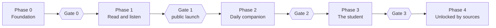

# Implementation plan

The PRD fixes what is built and in which phase (`docs/prd/PRD.ar.md` §8 and §12).
This file turns Phase 0 and Phase 1 into milestones that can each be finished,
reviewed and merged on their own. `docs/PROJECT_STATUS.md` says which milestone is
current. Requirement IDs (`RD-02`) refer to PRD §8; `NF-xx` to PRD §11.

No dates are given: durations are estimated at the end of Phase 0, as the PRD says.

## Phases and gates (PRD §12)

| Phase | Ships | Exit gate |
| --- | --- | --- |
| 0 Foundation | Rights register; pack pipeline with signing and checks; word index and mapping tables; proofread Hafs text; prototypes for both display modes, background audio, word highlight and a home-screen widget; size measurements; gesture usability check | Every pack needed for Phase 1 is `Ready` in `docs/SOURCES.md`. The text is signed off by the proofreader. Prototypes meet the performance limits. |
| 1 Read and listen | `RD`, `NV`, `SY`, `OF`, `AX`, `LV` complete. `AU` except 10, 18, 19, 21. `WQ-01`…`03`. `TF` except 09. Text search. `UD` except 06. `SH` except 04. Mini ayah sheet and basic word sheet. | Module acceptance criteria and §11 limits. Suggested minimum content: five recitations with documented rights, two of them with word timing, and two tafsirs. |
| 2 Daily companion | `TJ`, `PG`, `HF`, `AC`, `WG`; collections `UD-06`; audio `AU-10`, `18`, `19`, `21`; QR; riwayat `RW-01`…`04`; gharib `LX-06`; asbab al-nuzul `TF-09`; two-page view | Tajweed review gate; sync merge tests; approved ayah list for the widget |
| 3 The student | `LX-02`…`10`; root search `SR-09`; study hub and export `ST-02`…`05`; mutashabihat `MT-01`…`05`; qira'at differences `RW-05` if its condition is met | Licences settled; every word linked to the text; syntax-tree gate |
| 4 Unlocked by sources | The deferred features of PRD §13, one by one | Per feature: a grade A or B source, permission, signed review |

The table quotes PRD §12.2. Where it says a module is complete in Phase 1, the
requirement rows of PRD §8 are exact and the milestone tables below follow them:
`RD-18`, the two-page part of `RD-10`, `NV-04`, links from outside the app
(`NV-06`) and `AX-08` belong to Phase 2, and the reading mode of `RD-14` to Phase 3.
The surah information that `RD-17` opens is limited in Phase 1 to the basic facts
(Makki or Madani, ayah count, order); its further content comes later (PRD §6,
row 30).

Rules that never bend (PRD §12.1, §12.3):

- A phase does not open before the gate in front of it is met.
- Do not start a feature whose data source is not `Ready`.
- A conditional feature whose condition is unmet when its phase closes moves to the
  next phase. It does not delay the release.
- Every phase ends with a release that is usable on its own.
- The public launch follows Phase 1. Until Phase 2 ships, the home screen shows two
  doors (index, bookmarks).

Gate 0 and iOS. The prototypes are to be measured on both systems. If the owner
defers iOS builds (kickoff question K3), Gate 0 can still close on the Android
measurements, but only by his explicit decision, recorded in `docs/DECISIONS.md` with
the iOS measurements listed as owed and a milestone by which they are made. Without
that decision the gate stays open.

## Two workstreams

| Stream | Who | Works in |
| --- | --- | --- |
| **A — App** | The implementing account | Application code, generators in `tools/gen/`, `docs/CONTENT_PACKS.md` |
| **B — Content** | The planning session, the owner and his reviewers | Sources, extraction, the pipeline in `tools/packs/`, packs, verification, the PRD |

How the two meet:

- Only through this repository: pull requests and `docs/PROJECT_STATUS.md`. Neither
  stream relies on what the other "knows".
- Stream A writes the pack format in `docs/CONTENT_PACKS.md` (M0.3); stream B reviews
  it in the pull request and builds packs to it.
- Raw source files and extraction output never enter Git. The base pack enters the
  repository under `assets/` only as a signed file, after its sign-off (B0.2). Every
  other pack is hosted (O-08) and downloaded by the app.
- Source files that a spike needs before any host exists are fetched by the
  developer into the ignored `data/raw/`. Stream B makes that possible by recording,
  in `docs/content/`, where each file is downloaded from, its checksum and the note
  on its permission.

What stream A does while stream B is still working:

- Phase 0 engineering needs no content: it runs on synthetic packs whose text is
  plainly not Quran text.
- If stream A finishes M0.1–M0.4 before Gate 0 is met, it does **not** open Phase 1
  on its own. It works on M0.5.
- Opening a Phase 1 milestone before Gate 0 is the owner's decision. Ask with the
  `ask-owner` skill and name exactly what the gate still lacks. Even then a
  milestone is built only when every registry row it needs is `Ready`.

---

## Phase 0 — stream A

### M0.1 Repository and tooling

The repository holds the output of `flutter create` (package `holyquran`, Dart SDK
`^3.12.2`, placeholder id `com.example.holyquran`).

- [ ] Record the environment in `docs/PROJECT_STATUS.md`: host OS, `flutter --version`,
      `flutter doctor`, Android SDK, device or emulator, whether macOS is available,
      whether `gh` is installed and signed in, whether the Dart MCP server connected.
- [ ] Pin the Flutter version the project is built with: write it in the status
      file and use the same one in CI.
- [ ] Ask the owner the kickoff questions K1–K4 and apply the answers: application id
      and publisher name (O-01); platform folders (O-05); iOS builds (O-10); CI
      (D-029).
- [ ] `analysis_options.yaml`: `flutter_lints` plus strict casts, strict inference and
      strict raw types; agree the extra lint rules and record them.
- [ ] Replace the counter demo with the folder layout of `docs/ARCHITECTURE.md` and an
      empty shell that starts in Arabic, right to left, on the five-branch router
      with placeholder tabs.
- [ ] Localisation set up with a single `app_ar.arb`.
- [ ] GitHub Actions, if the owner agreed: format check, `flutter analyze` and
      `flutter test` on every push and every pull request.
- [ ] `README.md`: how to run, test and generate.

Done when: analyze is clean, tests pass locally and in CI, the shell launches on
Android. State in the status file whether an iOS build could be tried.

### M0.2 Design-system foundation

- [x] Token generator in `tools/gen/` reading `design/design-system/tokens.json`
      (ignoring `sample` and `usage`); generated tokens committed; theme extensions;
      the four themes; the follow-system option.
- [x] Fonts copied from `design/design-system/fonts/ttf/` to `assets/fonts/` and
      registered; a test compares their hashes with `design/README.md`; the three OFL
      texts included for the licences screen.
- [x] The three type questions of `docs/DESIGN_SYSTEM.md` settled and recorded: line
      height distribution, Reem Kufi's variable weight, fonts in golden tests.
- [x] Icons generated from the `ICONS` map.
- [x] Widgets: `Mark`, `Lockup`, `Icon`, `Button`, `IconButton`, `Switch`,
      `LevelSwitch`, `TabBar`, `QuranText`, `AyahMarker`, `SurahHeader`; helpers for
      Arabic-Indic digits and ayah counts.
- [x] A debug-only gallery screen showing every widget in the four themes.
- [x] Tests: goldens per widget and theme, tagged `golden`, with the way they are
      created and compared set up as `docs/DESIGN_SYSTEM.md` describes (a manually
      started CI workflow, or the recorded golden machine when there is no CI); the
      contrast test with the pairs, thresholds and known exceptions of that document
      (`AX-03`); the guards against design numbers in feature code and against
      importing the ramps outside `lib/ui/core/`.
- [x] The owner's answer on the follow-system option (O-15): D-050.
- [x] The list of icons Phase 1 needs beyond the identity's 26, compiled from PRD §8,
      and the owner's decision on who draws them (`docs/DESIGN_SYSTEM.md`, "Open
      design points").

Done in pull request #3 (D-050 to D-060). Partial: `QuranText` page size does not
centre its last line (`text-align-last`), left to spike S1 and M1.2.

Done when: the gallery matches the component previews (`design/preview/`) and the
`System`, `Colors` and `Type` boards, the owner has seen screenshots, and the tests
run in CI.

### M0.3 Domain core and pack reader

- [x] `QuranAddress` and `QuranRange` with parsing, printing, ordering and tests.
- [ ] `docs/CONTENT_PACKS.md`: the pack format, reviewed by the planning session.
      Written (format v1, D-064); the review, with questions P1–P7, is pending.
- [x] `PackManifest` and pack verification (SHA-256; signature once D-024 is settled),
      tested with a synthetic pack. The signature is a seam that reports "not
      checked" (D-065).
- [x] Read-only text repository and edition-map lookups.
- [x] The mechanism that keeps pack text untouched (`PackText`, proposed in
      `docs/ARCHITECTURE.md`), decided and recorded (D-062).
- [x] The integrity suite of PRD §9.4, ready to run against the real base pack
      (D-067). It has run on synthetic packs only.

Done in pull request #4 (D-061 to D-067). Pending: the planning session's review of
`docs/CONTENT_PACKS.md`, and the suite on the real base pack (B0.2). "Shows text"
is proven by the display test, which pumps `QuranText` with every ayah read through
the data layer; no screen reads a pack before M1.2.

Done when: the app shows text from the synthetic pack through `QuranText`, the
integrity suite passes on it, and nothing in `lib/` can write to a pack.

### M0.4 Spikes

Short experiments with measurements. Spike code lives in `spike/` on the milestone
branch and is deleted before the merge (D-068). Each result is a page in
`docs/spikes/`, committed on the milestone branch and merged like any other work; where a result
settles something it also gets an entry in `docs/DECISIONS.md`.

| Spike | Question | Feeds | Needs |
| --- | --- | --- | --- |
| S1 Surah-mode rendering | Does Amiri Quran shape correctly in Flutter? Word hit-testing and highlight boxes; reflow at 200%; laying out and scrolling a long surah; cold start to a saved position | `RD-02`, `SY-02`, `NF-01`, `NF-02` | The Tanzil Uthmani file, downloaded by the developer into the ignored `data/raw/` and never committed; its SHA-256 is recorded on the spike page |
| S2 Page-mode rendering | 604 pages from KFGQPC page fonts with the line layout; zoom; memory | `RD-03`, `RD-07` | B0.3 |
| S3 Background audio | Playback with the screen locked for 60 minutes; lock-screen and headset controls; ayah and word highlight from timing data | `AU-15`, `SY-01`, `SY-02`, `NF-09` | The playback part: any recording the owner may use. The highlight part: B0.5 |
| S4 Home-screen widget | An ayah in the mushaf font in a widget on both systems | `WG-03` (Phase 2) | S1 |
| S5 Downloads | Resumable queue, Wi-Fi only, verify then activate, rollback | `OF-04`…`06` | A local HTTP server is enough |
| S6 Sizes | Base app size; size of each pack | `NF-06` | Packs as they arrive |
| S7 Gestures | Usability check of the gesture map in PRD §7.4 | `RD`, `LX-01` | S1 |

Also decided here: audio and download packages, minimum OS versions (O-02), and the
two reference devices.

Part 1 (S1, S5, the S3 playback part) done in pull request #6 as partial: run on
Linux and in CI, device runs pending (`docs/spikes/`); O-02 decided (D-070); one
reference phone so far. Part 2 (S4, S7) next; S2, S6 and the S3 highlight part wait
for stream B.

### M0.5 Remaining design-system widgets (only while Gate 0 waits)

Branch `feat/m0-5-ds-widgets`. The Phase 1 components and board elements not built
in M0.2 (`AyahRow`, `SurahListItem`, `ProgressBar`, `MiniPlayer`, `ContinueCard`,
`ResourceRow`, `WordSheet`, `Tag`, `Stepper`, the search components, the home header
and doors, the reader's player bar, the share cards), each with its golden tests and
its entries in the contrast test, shown in the gallery with synthetic content. They
are the identity, not features, and need no source. Stop as soon as Gate 0 is met.

Amended by D-088: `Match` and `ContextSheet` move to M1.2, M1.3 and M1.8, the copy
sheet to M1.6; `ContinueListeningRow` and `Splash` are added. Plan in
`docs/plans/M0.5.md`.

### Phase 0 — stream B

| Task | Output |
| --- | --- |
| B0.1 Rights register | `docs/content/RIGHTS_REGISTER.md` filled in: one record per source, per book and per recitation, saying what its permission allows |
| B0.2 Base pack | Tanzil Uthmani 1.1 with its notice, metadata and the source's search forms; counts; SHA-256 per surah; character-by-character comparison with the KFGQPC Hafs text under a documented table of known encoding differences; proofreader's sign-off |
| B0.3 KFGQPC assets | Hafs text (update 2.0), page fonts and line layout for 1421H, checksums verified; a note in `docs/content/` with the download locations and checksums, so that spike S2 can fetch them; `testing/reference/kfgqpc-hafs-counts.json`, the per-surah ayah counts of the KFGQPC file, as the integrity suite's independent witness (`docs/CONTENT_PACKS.md`, P5) |
| B0.4 Word index | Tanzil words as the index, with the rule for mark-only tokens fixed (D-078) and the table of mark code points; mapping tables to KFGQPC words, to the search forms and to timing data; zero unmapped words |
| B0.5 Recitations | The list for Phase 1 (O-04), file sources, a rights record each, timing data, drift measured per recitation; a note in `docs/content/` with the download locations, so that spike S3 can fetch one recitation and its timing |
| B0.6 Zaydi Library | Extraction of the first-release books (done, 2026-10-07); approved honorific table; ayah linking (D-081: built for books 183, 514, 276 and 471, not reviewed; the other four books still to do); the reviewer's sample and the check of every flagged or unconfirmed link (D-082) — `docs/content/ZIYDIA_LIBRARY.md` |
| B0.7 Tafsir packs | The tafsirs chosen for Phase 1 (O-06), each sampled against print |
| B0.8 Waqf marks | Meanings of the marks transcribed from the Madinah mushaf's appendix and reviewed, and the list of marks checked against it (`WQ-02`). Not written from memory. Registry row 19 |
| B0.9 Surah facts | Makki or Madani, ayah count and order from the source metadata (`RD-17`) |
| B0.10 Acceptance data | The golden set of at least 200 search queries with the number of matches for each, taken from a reference independent of the app (`SR` criteria); three reference recitations with checked ayah boundaries (`AU` criteria) |
| B0.11 Pipeline | `tools/packs/`: source file to verified pack, with the checks of PRD §9.4 and the rules of the review in `docs/CONTENT_PACKS.md`; a synthetic source file and tests, so that it runs without any Quran text; the signing step (D-080). Signing needs the decision on the key (O-03) |

---

## Phase 1 — stream A

Suggested order. Each milestone lists its requirements; acceptance criteria are in the
PRD under the same module. The last column names the registry rows of
`docs/SOURCES.md` whose data the milestone shows. A row that is not `Ready` blocks
only the requirements that show its data, not the rest of the milestone: in M1.6,
row 19 blocks `WQ-02` and `WQ-03` and nothing else. "Per book" and "per recitation"
mean that the part can be built once at least one book or recitation has a `Complete`
rights record and a verified pack; each further item is added as it is cleared.

| Milestone | Requirements | Needs (B tasks, owner decisions) | Registry rows |
| --- | --- | --- | --- |
| M1.1 Shell, onboarding, settings | Five tabs; the home frame with its header and greeting; in-app splash; level choice at first run (anything more in onboarding waits for O-17); themes; settings; sources and licences screen. `LV-01`…`04`, `RD-08`, `AC-01`, `NF-13`, `NF-18` | O-17 | 17 |
| M1.2 Reader, surah mode | `RD-01`, `02`, `06`, `09`, `12`, `13`, `15`, `16`, `17`; the surah-mode part of `RD-05`, `07`, `11`; `WQ-01`; the continue-reading card on the home screen; the integrity alert when the base pack fails its check (PRD §9.5); the first user-database schema with its migration test (`NF-08`) | B0.2, B0.9 | 1, 4 |
| M1.3 Index and navigation | `NV-01`, `02`, `03`, `05`, `06` inside the app; the index door on the home screen | B0.2 | 1, 4 |
| M1.4 Resources and offline | `OF-01`…`07`; downloads over TLS (`NF-15`); the catalogue adds a pack with no app release (`NF-19`); the integrity alert for downloaded packs | A test host (O-08); a signed test pack from B0.11 | — |
| M1.5 Reader, page mode and second script | `RD-03`, `04`, `10` (both orientations), `19`; the page-mode part of `RD-05`, `07`, `11` | B0.3, B0.4 | 2, 3 |
| M1.6 Ayah tools | The ayah toolbar (PRD §7.4, §7.7); ayah cards in lists (`RD-14`); `UD-01`…`05`, `07`; `WQ-02`, `03`; `SH-01`, `02`, `03`, `05`; the mini ayah sheet `ST-01` with its ayah and notes sections; the word sheet `LX-01` with its text tab, and `LX-11`; the bookmarks door on the home screen | B0.8; the missing icons | 19 |
| M1.7 Tafsir | `TF-01`…`06`, `08`, `10`; the tafsir section of `ST-01` and the tafsir tab of the word sheet | B0.7, and B0.6 for Zaydi-library books | 9 and 10; 18 per book; 8 per book |
| M1.8 Search | `SR-01`…`08`, `SR-10`; search inside tafsirs `TF-07` | B0.2, B0.4, B0.10 | 1; for `TF-07` the rows of M1.7 |
| M1.9 Audio | `AU-01`…`09`, `11`…`17`, `22`…`24`; the «أكمل الاستماع» row on the home screen (with `AU-16`); the audio section of `ST-01`; `AX-07`; `NF-04`, `NF-09`, `NF-12` | B0.5, B0.10 | 7 and 6, per recitation |
| M1.10 Audio and text in sync | `SY-01`…`05`; playing one word `AU-20` | B0.4, B0.5 | 6, per recitation |
| M1.11 Accessibility, performance, release readiness | A full pass of `AX-01`…`06`, `09` over every screen; `NF-01`, `02`, `03`, `05`, `06`, `07`, `11`, `14`, `17`, `20`, `21`; launcher icon and native launch screen; store compliance (PRD §11.1) | Reference devices; the logo files; O-11; O-18 | — |

Notes:

- `ST-01` and `LX-01` are finished only when their last part arrives (M1.9 and M1.7).
  Until then the pull request says which sections exist.
- The accessibility requirements apply to every milestone through the checklist in
  `docs/DESIGN_SYSTEM.md`; M1.11 is the audit of the whole, not the first time they
  are met.

Phase 2 onward is planned in the same way when Phase 1 nears its gate.

---

## Definition of done

**A task**

- Code follows `docs/ARCHITECTURE.md` and, for UI, passes the checklist in
  `docs/DESIGN_SYSTEM.md`.
- Tests written with the change; `dart format`, `flutter analyze` and `flutter test`
  are clean.
- Committed in English, naming the requirement ID or, where there is none, the
  milestone; pushed.

**A milestone**

- Every requirement listed is implemented and its PRD acceptance criteria are checked
  one by one in the pull request description, each with its test or evidence.
- A criterion that needs a device, a reviewer or the owner, and cannot be checked
  yet, is named in the pull request and listed in the status file under "Pending
  human checks". The milestone may merge with such checks open; it is then reported
  as merged with checks pending, never as complete.
- Reviewed by the `code-reviewer` agent, and by `identity-auditor` if it touches UI.
- `docs/PROJECT_STATUS.md` updated in the branch; CI green; pull request merged.

**A phase**

- Its gate is met, with no human check pending, and recorded in the status file with
  evidence.
- An annotated tag `phase-N-complete` marks the merge commit.
- The owner has seen the result and said so.
